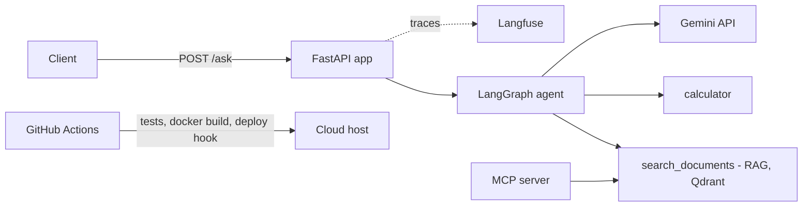

# Document assistant service (block 11)

An LLM agent that answers questions about a set of notes (urban flooding and ESG reporting). The agent from block 8 and 9, now as a web service with tests, CI and tracing.

How it works: the agent (LangGraph) can call two tools, a document search (RAG with Qdrant and Gemini embeddings) and a calculator. It keeps memory per thread in SQLite. A FastAPI app puts it behind an API, and the same search tool is also available as an MCP server.

## Endpoints

- GET /health returns {"status": "ok"}
- POST /ask with {"question": "...", "thread_id": "abc"} returns the answer and which tools the agent used

## Settings (environment variables)

GEMINI_API_KEY (required), LANGFUSE_PUBLIC_KEY, LANGFUSE_SECRET_KEY, LANGFUSE_HOST (optional, turns on tracing), DATA_DIR, GEN_MODEL, LOG_LEVEL. See .env.example. Secrets are never in the code or the image.

## Run it

    pip install -r requirements.txt -r requirements-dev.txt
    python -m pytest -q tests
    uvicorn app:app --reload

With Docker:

    docker build -t freight-service .
    docker run -p 8000:8000 -e GEMINI_API_KEY=your_key freight-service

## MCP server

    python mcp_server.py

It offers two tools, search_documents and calculator, to any MCP client over stdio.

## CI/CD

.github/workflows/block11.yml runs the tests and builds the Docker image on every push. On main it also calls a deploy hook (secret DEPLOY_HOOK_URL) so the host redeploys.

## Limits

The index is built in memory on the first question, so the first request is slow. The free model tier is rate limited, so answers take a few seconds. Only a small sample corpus is included.
